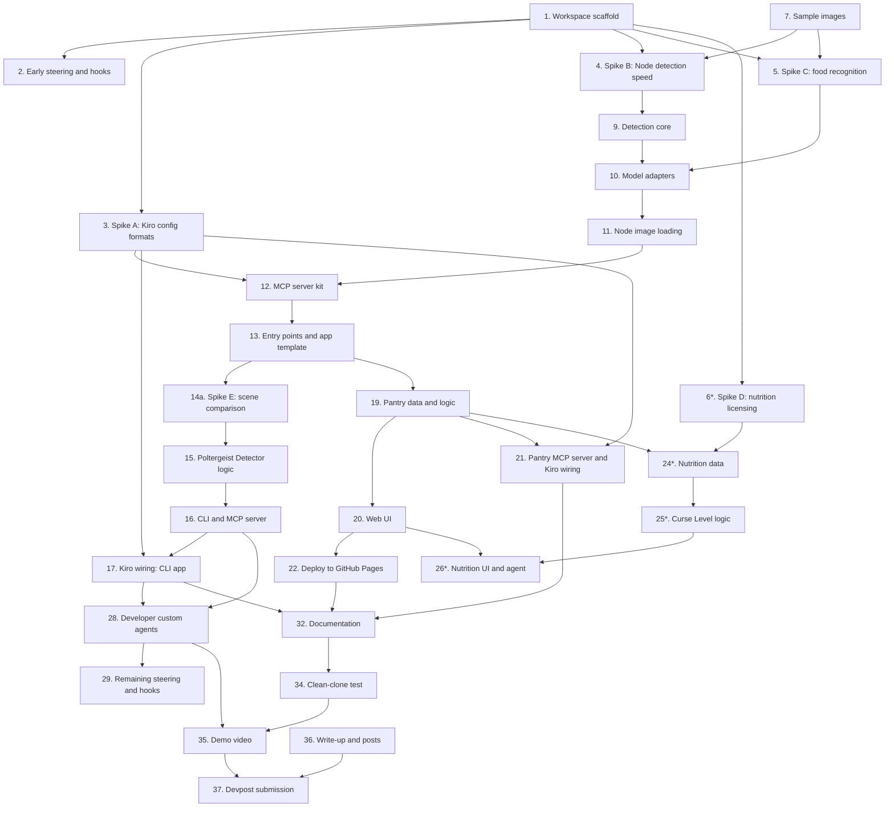

# Implementation Plan

## Overview

This plan builds the Skeleton Crew submission in eight phases: workspace setup, early spikes to test risky assumptions, the shared skeleton package, the Poltergeist Detector CLI, the Witch's Pantry web app, the optional nutrition feature (Curse Level and Potion Purity), the Kiro layer (custom agents, hooks, steering), and the submission package. Each task points to the requirements it covers in `requirements.md` and follows the architecture in `design.md`.

Deadline: **4 December 2026**. Target submission date: **Wednesday 2 December**, leaving two days of buffer. Tasks marked `*` are stretch; see Notes for the cut order and the definition of done.

## Tasks

### Phase 0: Already done

- [x] 0.1 Requirements and design written and reviewed
- [x] 0.2 Node pinned to 22.23.0 in `.nvmrc`, `engines.node >=22` set
- [x] 0.3 pnpm pinned to 10.34.9 in `package.json`
- [x] 0.4 `AGENTS.md` updated with project rules, `KIRO_USAGE.md` started
- [x] 0.5 Unrelated file moved out of the repo

### Phase 1: Workspace setup (week 1)

- [x] 1. Scaffold the pnpm workspace
  - [x] 1.1 Create `pnpm-workspace.yaml` (`packages/*`, `apps/*`), rename the root package to `skeleton-crew`, set `"license": "MIT"`, and add `pnpm.onlyBuiltDependencies` (start with `esbuild`)
    - Remove the empty root `src/` folder
    - _Requirements: 1.1, 12.1_
  - [x] 1.2 Add the MIT `LICENSE` file at the root
    - _Requirements: 12.1_
  - [x] 1.3 Convert the root `tsconfig.json` into `tsconfig.base.json` (keep the strict options) and add per-package `tsconfig.json` files that extend it, with `types: ["node"]` only where needed
    - _Requirements: 1.1_
  - [x] 1.4 Create empty package shells: `packages/skeleton`, `apps/poltergeist-detector`, `apps/witches-pantry`, each with its own `package.json` (`"type": "module"`, apps depend on `@skeleton-crew/core` through `workspace:*`)
    - _Requirements: 1.1, 1.5_
  - [x] 1.5 Create `.gitignore` with `node_modules/`, `dist/`, and `.env*`. Do not ignore `.kiro/` or anything inside it
    - _Requirements: 12.3_
  - [x] 1.6 Install TypeScript, Vitest, fast-check, and tsx with exact versions (`pnpm add --save-exact -D`). Add root scripts `typecheck`, `test`, `build`. Add one placeholder test to prove `pnpm test` runs
    - _Requirements: 1.3, 10.x_

- [x] 2. Early Kiro setup so it helps while building
  - [x] 2.1 Write `.kiro/steering/project-structure.md` (stack, folder layout, naming, the "skeleton stays generic" rule)
    - _Requirements: 9.1_
  - [x] 2.2 Create the **test-on-save** hook with `createHook` (PostFileSave on `.ts` files, runs the tests)
    - _Requirements: 8.1_
  - [x] 2.3 Create the **usage-log-on-task** hook (PostTaskExec, appends a short entry to `KIRO_USAGE.md`)
    - _Requirements: 8.3_

### Phase 2: Spikes (week 1, each time-boxed to half a day)

Each spike ends with a written decision in `design.md` and a line in `KIRO_USAGE.md`. If a spike fails, the design is updated before any build task that depends on it.

- [x] 3. Spike A: Kiro configuration formats (blocks tasks 17, 21.2, and 28)
  - Build a throwaway MCP server with one `hello` tool using `@modelcontextprotocol/server` v2, run it with `pnpm dlx @modelcontextprotocol/inspector`, then register it in `.kiro/settings/mcp.json` and confirm Kiro lists and can call the tool
  - Find out whether Kiro resolves a relative path in `args` from the workspace root, and what to do if not
  - Read the current Kiro custom agent documentation, create one tiny custom agent, and confirm it can use only the allowed MCP tools. Record the exact file format and location
  - Confirm no `console.log` reaches stdout
  - _Requirements: 3.7, 4.1, 4.3_

- [x] 4. Spike B: detection speed in Node
  - Run COCO-SSD on the pure-JS CPU backend with JPEG and PNG decoding through `jpeg-js` and `pngjs`. Measure model load time, time per image, and memory on 10 sample images
  - Decision: acceptable as is, resize inputs first, or document `@tensorflow/tfjs-node` as an optional speed-up
  - _Requirements: 2.1, 2.5_

- [x] 5. Spike C: food recognition quality
  - Take or collect about 15 photos of your own: fruit, vegetables, a mixed fridge shelf, packaged food
  - Run the MobileNet-style classifier in Node and the browser. Record which target ingredients (tomato, onion, potato, egg, cheese, etc.) are recognized and which are not
  - Decision gate: if recognition is poor, the editable chips and a "quick add" list become the primary input and detection is the helper. Update `design.md` either way
  - _Requirements: 6.6, 6.7_

- [x]* 6. Spike D: nutrition data licensing
  - Confirm the USDA FoodData Central license and the FDA Daily Values used in the Curse Level formula. Write the credit line for the README
  - _Requirements: 14.3_

- [x] 7. Collect sample images
  - 12 to 20 photos taken by you (food, a desk, pets or toys, a street scene). No stock photos with unclear licenses, no logos or brands
  - Store in `samples/` with a short `samples/README.md` stating they are your own work
  - Done with a reduced set: 4 original photos (all food or kitchen) plus rotated copies, 15 files in total, with brands and logos pixelated. Still missing: the before and after photo pair for the Poltergeist Detector, which Spike E (task 14a) collects
  - _Requirements: 4.4, 12.6_

- [x] 8. Checkpoint: spikes complete. Update `design.md`, `KIRO_USAGE.md`

### Phase 3: Skeleton package (weeks 1 to 2)

- [x] 9. Detection core (browser-safe)
  - [x] 9.1 Define `Detection`, `DetectOptions`, `Detector`, `ModelAdapter`, and typed errors (`UnsupportedImageError`)
    - _Requirements: 2.2, 2.4_
  - [x] 9.2 Implement `filterByConfidence` and `countByLabel`
    - _Requirements: 2.3, 3.2_
  - [x] 9.3 Property test: the sum of `countByLabel` counts equals the number of detections
    - _Requirements: 10.1_
  - [x] 9.4 Property test: every detection kept by `filterByConfidence` has confidence at or above the threshold
    - _Requirements: 10.2_
  - [x] 9.5 Implement the `Detector` class around a `ModelAdapter` (loads the model once and reuses it), tested with a fake adapter so tests run offline
    - _Requirements: 2.5, 2.6_

- [x] 10. Model adapters
  - [x] 10.1 `CocoSsdAdapter` (works in Node and the browser)
    - _Requirements: 2.1, 2.6_
  - [x] 10.2 `MobileNetFoodAdapter` with an allowlist of food labels passed in by the app, shaped by the results of Spike C
    - _Requirements: 2.2, 6.6_
  - [x] 10.3 Optional integration test that loads the real models, skipped unless `RUN_MODEL_TESTS=1`
    - _Requirements: 2.1_

- [x] 11. Node image loading
  - Load an image from a file path or base64 into pixels, support JPEG and PNG, reject other formats with `UnsupportedImageError`
  - Only read files inside an allowed root, and cap base64 size
  - _Requirements: 2.1, 2.4_

- [x] 12. MCP server kit (Node-only)
  - [x] 12.1 Tool registry that rejects a duplicate name at registration
    - _Requirements: 3.6_
  - [x] 12.2 Tool wrapper: Zod validation before the handler, and a thrown error becomes an error result while the server keeps running
    - _Requirements: 3.4, 3.5_
  - [x] 12.3 Built-in `detect_objects` and `count_objects` tools, plus a `serveStdio` helper that logs only to stderr
    - _Requirements: 3.1, 3.2, 3.3, 3.7_
  - [x] 12.4 Property test: registering any tool name twice always fails
    - _Requirements: 10.3_
  - [x] 12.5 Property test: any input that fails the schema returns a validation error and never calls the handler
    - _Requirements: 10.4_

- [x] 13. Package entry points and the app template
  - [x] 13.1 Browser-safe entry point and Node-only entry point in `package.json` `exports`. Add a build check that the browser entry pulls in no Node modules
    - _Requirements: 1.2_
  - [x] 13.2 App_Agent template and `packages/skeleton/README.md` explaining how to create a new app
    - _Requirements: 1.4, 4.5_

- [x] 14. Checkpoint: run the built-in tools through the MCP Inspector on a sample image, then update `KIRO_USAGE.md`

### Phase 4: Poltergeist Detector CLI (week 2)

- [ ] 14a. Spike E: scene comparison on real photos (blocks task 15)
  - Take two photos of the same desk or shelf from the same spot (a phone propped on a book works), then move two or three objects between them and remove one. Save them as your own photos in `samples/` (for example `desk-before.jpg` and `desk-after.jpg`), with no brand names, logos, people, or screens showing anything personal
  - Run COCO-SSD on both and list what it detects. Check three things: does it find the same objects in both photos when nothing changed, how far do box centres drift between two photos of an unchanged scene, and does a moved object keep its label
  - Take a third photo of the unchanged desk from the same spot and compare it with the first. The result should report nothing, and anything it does report is a false change that the thresholds must absorb
  - Decision: set the default `moveTolerance` and confidence threshold from the measured drift, and record in `design.md` whether the idea works. If the false changes are too many to fix with thresholds, the fallback is to compare counts per label only (appeared and vanished, no "moved")
  - _Requirements: 5.1, 5.3, 5.6_

- [ ] 15. App logic
  - [ ] 15.1 `compareScenes` pure function as described in `design.md`: match Detections per label by normalized box-centre distance, then report appeared, vanished, moved and unchanged
    - _Requirements: 5.1, 5.10_
  - [ ] 15.2 Property test: every Detection in the "before" list is reported exactly once (vanished, moved, unchanged) and every Detection in the "after" list exactly once (appeared, moved, unchanged)
    - _Requirements: 10.5_
  - [ ] 15.3 Property tests: swapping "before" and "after" swaps the appeared and vanished counts per label, and comparing a scene with itself reports nothing appeared, vanished or moved
    - _Requirements: 10.6_
  - [ ] 15.4 Example tests for the tolerance edges: an object just inside and just outside `moveTolerance`, Detections without a bounding box, two objects of one label swapping places, and empty lists
    - _Requirements: 5.6, 5.9_
  - [ ] 15.5 Report formatter: human-readable "haunting report" and JSON output, with a clear message when nothing was detected in either photo
    - _Requirements: 5.3, 5.4, 5.9_
  - [ ] 15.6 Scene loader: run the Detector on both photos one after the other, and name the photo that failed if one cannot be read
    - _Requirements: 5.8_

- [ ] 16. CLI and MCP server
  - [ ] 16.1 CLI with `util.parseArgs`: `compare <before> <after>`, `--json`, `--min-confidence`, `--tolerance`, `--help`. Results go to stdout and progress to stderr. Exit code 1 when a photo is missing or unsupported. The usage text says to take both photos from the same spot
    - _Requirements: 5.3, 5.4, 5.5, 5.6, 5.7, 5.8_
  - [ ] 16.2 `bin` entry so `poltergeist-detector compare <before> <after>` works after `pnpm link --global`
    - _Requirements: 5.3_
  - [ ] 16.3 MCP server entry registering `compare_scenes` on top of the built-ins, using the same `compareScenes` logic as the CLI
    - _Requirements: 5.1, 5.10_
  - [ ] 16.4 Unit tests for argument parsing, exit codes, and the error paths
    - _Requirements: 5.7, 5.8, 5.9_

- [ ] 17. Kiro wiring for the CLI app
  - Add the server to `.kiro/settings/mcp.json`, write the App_Agent (poltergeist-investigator persona, only this app's tools), try it in Kiro on the before and after photos, and keep a screenshot
  - _Requirements: 4.1, 4.2, 4.3, 5.2_

- [ ] 18. Checkpoint: run the CLI on the before and after photos in `samples/` end to end, then update `KIRO_USAGE.md`

### Phase 5: The Witch's Pantry core (weeks 2 to 3)

- [ ] 19. Data and logic
  - [ ] 19.1 Recipe dataset: at least 25 original recipes themed as potions, with normalized ingredient names, grams per ingredient, and servings. Add a schema test
    - _Requirements: 6.15, 14.1_
  - [ ] 19.2 Label to ingredient mapping, with synonyms (for example "Granny Smith" to apple), based on Spike C
    - _Requirements: 6.6, 6.7_
  - [ ] 19.3 `suggestRecipes`: name-based matching that returns matched and missing ingredients and sorts by match
    - _Requirements: 6.1, 6.8, 6.9_
  - [ ] 19.4 Property tests: every returned recipe matches at least one ingredient, adding an ingredient never lowers a recipe's matched count, and matched plus missing equals the recipe's ingredient names with no overlap
    - _Requirements: 10.7, 10.8, 10.9_

- [ ] 20. Web UI
  - [ ] 20.1 Vite and TypeScript app shell with the witch's-pantry theme, semantic HTML, and visible focus styles
    - _Requirements: 6.3, 6.13_
  - [ ] 20.2 Image select and drop with a keyboard-accessible file button, a loading state announced with `aria-live`, and an error message for unsupported files
    - _Requirements: 6.5, 6.10, 6.11_
  - [ ] 20.3 Canvas overlay: boxes for localized detections and labelled tags for whole-image classifications
    - _Requirements: 6.5_
  - [ ] 20.4 Ingredient chips: remove, add by typing, and a quick-add list. Changing the list re-runs `suggestRecipes`
    - _Requirements: 6.7, 6.8_
  - [ ] 20.5 Recipe cards showing matched and missing ingredients, and an empty state when nothing matches
    - _Requirements: 6.9, 6.12_
  - [ ] 20.6 Accessibility pass: keyboard-only walkthrough, screen reader text for detections and recipes, colour contrast
    - _Requirements: 6.13_

- [ ] 21. MCP server and Kiro wiring
  - [ ] 21.1 MCP server entry (Node) registering `suggest_recipes` and using the food adapter for `detect_objects`, sharing the same recipe logic as the UI
    - _Requirements: 6.1, 6.14_
  - [ ] 21.2 Add to `.kiro/settings/mcp.json`, write the App_Agent (witch's pantry persona), and test it in Kiro
    - _Requirements: 4.1, 4.2, 4.3, 6.2_

- [ ] 22. Deploy
  - GitHub Pages workflow for `witches-pantry`, correct Vite `base` path, and a check from the public URL in a private browser window. Record the first-load model download size and time
  - _Requirements: 6.4, 13.2_

- [ ] 23. Checkpoint: use the deployed app with 5 different photos, then update `KIRO_USAGE.md`

### Phase 6: Nutrition, Curse Level, Potion Purity (week 3, stretch)

- [ ]* 24. Data
  - [ ]* 24.1 `nutrition.json` for the ingredients used by the recipes, from the source confirmed in Spike D, with a `source` field per entry
    - _Requirements: 14.2, 14.3_
  - [ ]* 24.2 Data check test: calories are consistent with protein, carbs, and fat per ingredient
    - _Requirements: 14.13_

- [ ]* 25. Logic
  - [ ]* 25.1 `nutritionPerServing`, with a property test that scaling amounts and servings together leaves the result unchanged
    - _Requirements: 14.4, 10.12_
  - [ ]* 25.2 `curseLevel`, `potionPurity`, and `dominantCurse`, with property tests for the 0 to 100 bounds and the monotonic direction for each nutrient
    - _Requirements: 14.5, 14.6, 10.10, 10.11_
  - [ ]* 25.3 `sortBy: 'purity'` in `suggestRecipes`, with a property test that Curse Levels never decrease down the list
    - _Requirements: 14.8, 10.13_
  - [ ]* 25.4 Extend the `suggest_recipes` output with nutrition, Curse Level, and purity
    - _Requirements: 14.11_

- [ ]* 26. UI and agent
  - [ ]* 26.1 "Best match / Purest first" radio toggle, potion meter with text label, nutrition list, tip, and the disclaimer note
    - _Requirements: 14.7, 14.8, 14.9, 14.10_
  - [ ]* 26.2 Update the Pantry App_Agent prompt with the wording rule (ingredients and amounts only)
    - _Requirements: 14.12_

- [ ]* 27. Checkpoint: review every tip and label against the wording rule, then update `KIRO_USAGE.md`

### Phase 7: Kiro layer (build as soon as the pattern is stable, finish in week 4)

- [ ] 28. Developer custom agents
  - [ ] 28.1 `tool-builder` agent, written after the CLI app exists so it captures real conventions. Test it by asking it to add a small tool and check the result follows the steering file
    - _Requirements: 7.1, 7.3_
  - [ ] 28.2 `app-generator` agent that creates a new app folder, MCP entry, `mcp.json` entry, and App_Agent from the template
    - _Requirements: 7.2, 7.3_
  - [ ] 28.3 Record a clean run of `app-generator` creating a third demo app for the video, confirm it builds, then discard it. The repo must contain exactly two applications
    - _Requirements: 7.2, 1.1_

- [ ] 29. Remaining steering and hooks
  - [ ] 29.1 `adding-a-tool.md` with `fileMatch` on the tool folders, and `adding-an-agent.md`
    - _Requirements: 9.2, 9.3, 9.4_
  - [ ] 29.2 Hook that checks a newly created tool file is registered and documented
    - _Requirements: 8.2_

- [ ] 30. Compare surfaces and powers
  - Check the Powers available in your Kiro and try the ones relevant to TypeScript, MCP, or testing. Note what each one added or didn't
  - Run one custom agent task from the Kiro CLI and note how it differed from the IDE
  - _Requirements: 11.1_

- [ ] 31. Spec versus vibe coding note
  - Build one small piece without a spec (a utility in the web UI, for example) and compare effort and quality with spec-driven tasks
  - _Requirements: 11.3_

### Phase 8: Submission (week 4 and buffer)

- [ ] 32. Documentation
  - [ ] 32.1 Root `README.md`: what it is, features of the skeleton and both apps, Node and pnpm versions with install steps, deployed URL, how to run the CLI, credits and licenses for models and data
    - _Requirements: 1.6, 12.5_
  - [ ] 32.2 README for each app with setup and run instructions
    - _Requirements: 1.5, 12.4_

- [ ] 33. Repository checks
  - Confirm `.gitignore` does not exclude `.kiro/`, there is no copyrighted material or secret in the repo, and the README credits the model and data sources
  - After pushing: confirm the LICENSE shows in the GitHub About section, add a description and topics
  - _Requirements: 12.1, 12.2, 12.3, 12.6_

- [ ] 34. Clean-clone test
  - Clone into a fresh folder, run `nvm use`, `pnpm install`, `pnpm test`, `pnpm build`, run the CLI on the before and after photos in `samples/`, and open the deployed URL. Fix everything that breaks
  - _Requirements: 1.3, 1.7, 12.4_

- [ ] 35. Demo video (3 minutes or less, YouTube public)
  - Outline: problem and audience (15s), Witch's Pantry end to end (60s), Poltergeist Detector CLI plus Kiro calling the MCP tools (45s), `app-generator` making a third app (30s), the Kiro features used (20s)
  - Original or royalty-free audio only, no third-party logos, recorded on the machine the project was built on
  - _Requirements: 13.5, 13.10_

- [ ] 36. Write-up and posts
  - [ ] 36.1 Finish `KIRO_USAGE.md` with concrete examples for every rubric item and use it for the Devpost write-up
    - _Requirements: 11.1, 11.2, 11.3, 13.6_
  - [ ]* 36.2 Blog post on a third-party platform, published within the submission period, mentioning "Kiroween Hackathon 2026"
    - _Requirements: 13.8_
  - [ ]* 36.3 Social post that starts with `#KiroweenHackathon26`, written in your own words with a real insight about Kiro
    - _Requirements: 13.9_

- [ ] 37. Devpost submission
  - Select Skeleton Crew, add the repo URL, deployed URL, CLI instructions, description, video link, write-up, and bonus links. Submit by 2 December
  - _Requirements: 13.1, 13.2, 13.3, 13.4, 13.7, 13.11_

## Task Dependency Graph

Checkpoint tasks (8, 14, 18, 23, 27) follow the phase they close. Tasks 30, 31, and 33 have no hard dependencies and fit in whenever there is time, before task 37.

## Notes

### Definition of done

- Every coding task is done when `pnpm typecheck` and `pnpm test` pass under Node 22.23.0. Run `nvm use` in the project folder first.
- Property tests for the skeleton and both apps are must-have, because property-based testing is part of the judged Kiro usage. Only the Phase 6 property tests are stretch, since the whole nutrition feature is stretch.
- Never commit from the agent. The user commits.

### Cut order if the schedule slips

1. Requirement 14 (nutrition, Curse Level, Potion Purity)
2. Social post
3. Blog post
4. Kiro CLI comparison

The two apps, the skeleton, the Kiro layer, the video, and the README are never cut.

### Evidence for the write-up

Each phase ends with a checkpoint. Add a short, concrete entry to `KIRO_USAGE.md` at every checkpoint: what Kiro did, what went wrong, and what changed because of it. Screenshots count as evidence.

### Suggested schedule

| Week | Dates | Focus |
|---|---|---|
| 1 | 2 to 8 Nov | Setup, spikes, skeleton |
| 2 | 9 to 15 Nov | Poltergeist Detector CLI, start Witch's Pantry core |
| 3 | 16 to 22 Nov | Witch's Pantry core and deploy, stretch nutrition |
| 4 | 23 to 29 Nov | Kiro layer polish, READMEs, video, blog, social |
| Buffer | 30 Nov to 3 Dec | Clean-clone test, fixes, submit by 2 Dec |
